# readify

A new Flutter project.

## Getting Started

This project is a starting point for a Flutter application.

A few resources to get you started if this is your first Flutter project:

- [Learn Flutter](https://docs.flutter.dev/get-started/learn-flutter)
- [Write your first Flutter app](https://docs.flutter.dev/get-started/codelab)
- [Flutter learning resources](https://docs.flutter.dev/reference/learning-resources)

For help getting started with Flutter development, view the
[online documentation](https://docs.flutter.dev/), which offers tutorials,
samples, guidance on mobile development, and a full API reference.

# Readify — Personal Book Library & Reading Tracker

Readify merupakan aplikasi mobile berbasis Flutter yang dirancang untuk membantu pengguna mencari buku, mengelola koleksi bacaan pribadi, serta memantau perkembangan aktivitas membaca. Aplikasi ini mengintegrasikan Open Library API sebagai sumber informasi buku dan Supabase sebagai backend untuk penyimpanan data koleksi pribadi.

## Identitas Mahasiswa

| Keterangan | Informasi |
|---|---|
| Nama Project | Readify |
| Nama | Kadek Martini Aristianti |
| NIM | 2415051004 |
| Kelas | PTI 5 C |
| Program Studi | Pendidikan Teknik Informatika |
| Branch Utama | main |

## Repository

GitHub Repository:

[UTS_2415051004-Kadek-Martini-Aristianti](https://github.com/kadekmartini/UTS_2415051004-Kadek-Martini-Aristianti.git)

## Daftar Fitur

1. **Beranda:** Menampilkan rekomendasi buku dari Open Library dan ringkasan statistik koleksi pribadi.
2. **Jelajah Buku:** Mencari buku berdasarkan judul atau nama penulis.
3. **Detail Buku:** Menampilkan informasi buku dari hasil pencarian API.
4. **Tambah Buku:** Menambahkan buku ke koleksi pribadi.
5. **Edit Buku:** Memperbarui status membaca, rating, dan catatan pribadi.
6. **Rak Saya:** Menampilkan dan mengelola seluruh koleksi buku yang tersimpan.
7. **Detail Buku Tersimpan:** Menampilkan informasi koleksi serta menyediakan fitur edit dan hapus.
8. **Profil:** Menampilkan identitas mahasiswa dan statistik koleksi bacaan.

Fitur pengelolaan koleksi mencakup Create, Read, Update, dan Delete (CRUD).

Status membaca yang tersedia:
- Ingin Dibaca
- Sedang Dibaca
- Selesai Dibaca

## Tech Stack

| Teknologi | Kegunaan |
|---|---|
| Flutter | Framework pengembangan aplikasi mobile |
| Dart | Bahasa pemrograman |
| Provider | State management |
| HTTP | Komunikasi dengan REST API |
| Supabase Flutter | Integrasi aplikasi dengan Supabase |
| PostgreSQL | Database untuk koleksi buku |
| Open Library | Sumber informasi dan sampul buku |

Dependency utama berdasarkan `pubspec.yaml`:

- provider: ^6.1.5+1
- http: ^1.6.0
- supabase_flutter: ^2.18.3
- cupertino_icons: ^1.0.8

Development dependency:
- flutter_test
- flutter_lints: ^6.0.0

## REST API

Readify menggunakan **Open Library Search API** untuk mencari dan mengambil informasi buku.

URL utama:

https://openlibrary.org/search.json

API digunakan untuk memperoleh informasi:
- Judul buku.
- Nama penulis.
- Tahun publikasi pertama.
- Jumlah edisi.
- Subjek buku.
- Identitas sampul buku.

Pencarian dilakukan berdasarkan kata kunci yang dimasukkan pengguna. Beranda juga mengambil rekomendasi buku menggunakan kata kunci `fiction`.

Dokumentasi resmi:

https://openlibrary.org/dev/docs/api/search

Open Library Covers API digunakan untuk menampilkan sampul buku:

https://covers.openlibrary.org/b/id/{cover_i}-M.jpg

## Backend dan Database

Readify menggunakan **Supabase** sebagai backend dengan PostgreSQL sebagai database.

Project URL:

https://rfkglblbdmcvrqotoyik.supabase.co

Nama tabel utama:

`reading_items`

Tabel tersebut digunakan untuk menyimpan koleksi buku pribadi dengan data seperti:
- id
- user_id
- open_library_key
- title
- author
- cover_url
- publish_year
- status
- rating
- notes
- created_at
- updated_at

Operasi database yang diterapkan meliputi:
- SELECT untuk membaca koleksi.
- INSERT untuk menambahkan buku.
- UPDATE untuk memperbarui data buku.
- DELETE untuk menghapus buku.

Struktur database tersedia pada:

`supabase/schema.sql`

Dashboard Supabase:

https://supabase.com/dashboard/

## Arsitektur Aplikasi

Readify menggunakan pemisahan tanggung jawab antara antarmuka pengguna, pengelolaan state, repository, dan sumber data.

Alur integrasi Open Library:

```text
DiscoverScreen / HomeScreen
          |
          v
    CatalogProvider
          |
          v
    BookRepository
          |
          v
 OpenLibraryService
          |
          v
   Open Library API
```

Alur pengelolaan koleksi pribadi:

```text
LibraryScreen / AddEditBookScreen
              |
              v
       ReadingProvider
              |
              v
      ReadingRepository
              |
              v
       Supabase Client
              |
              v
       Supabase Database
              |
              v
        reading_items
```

Penjelasan lapisan:

1. **Screens:** Menampilkan antarmuka dan menerima interaksi pengguna.
2. **Widgets:** Menyediakan komponen antarmuka yang dapat digunakan kembali.
3. **Providers:** Mengelola state, loading, data, dan error.
4. **Repositories:** Menangani akses dan pengelolaan data.
5. **Services:** Menangani komunikasi dengan Open Library API.
6. **External Data Sources:** Open Library API dan Supabase Database.

## Struktur Folder Project

```text
readify/
├── android/
├── lib/
│   ├── core/
│   │   └── app_theme.dart
│   ├── models/
│   │   ├── book.dart
│   │   └── reading_item.dart
│   ├── providers/
│   │   ├── catalog_provider.dart
│   │   └── reading_provider.dart
│   ├── repositories/
│   │   ├── book_repository.dart
│   │   └── reading_repository.dart
│   ├── screens/
│   │   ├── main_shell.dart
│   │   ├── home_screen.dart
│   │   ├── discover_screen.dart
│   │   ├── book_detail_screen.dart
│   │   ├── add_edit_book_screen.dart
│   │   ├── library_screen.dart
│   │   ├── saved_book_detail_screen.dart
│   │   └── profile_screen.dart
│   ├── services/
│   │   └── open_library_service.dart
│   ├── widgets/
│   │   ├── book_cover.dart
│   │   ├── book_card.dart
│   │   ├── reading_item_card.dart
│   │   └── feedback_state.dart
│   └── main.dart
├── supabase/
│   └── schema.sql
├── test/
│   └── widget_test.dart
├── docs/
│   └── screenshot/
├── pubspec.yaml
└── README.md
```

## Responsive Layout

Readify menyediakan tampilan yang menyesuaikan ukuran layar.

- Compact layout menggunakan navigasi bawah dan susunan konten yang sesuai untuk layar mobile.
- Wide layout menggunakan NavigationRail serta susunan GridView untuk menampilkan koleksi buku.
- LayoutBuilder digunakan untuk menyesuaikan susunan komponen berdasarkan lebar layar.

## Screenshot Aplikasi

Screenshot aplikasi akan disimpan pada direktori `docs/screenshot/`.

### Beranda

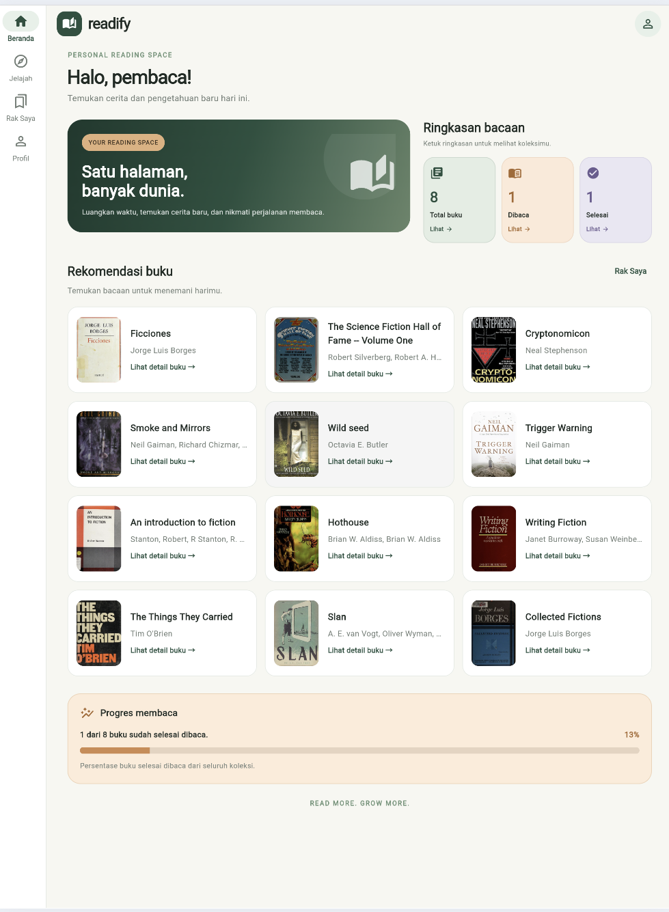

### Jelajah Buku

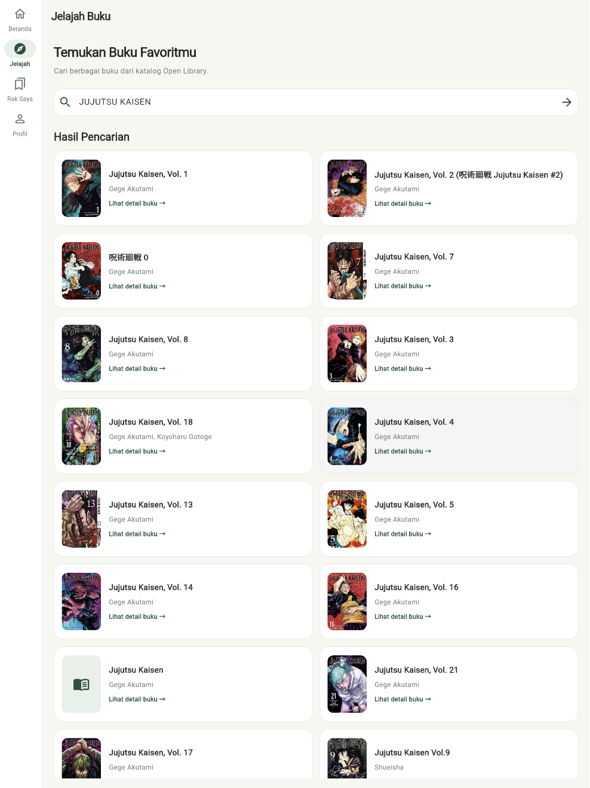

### Detail Buku

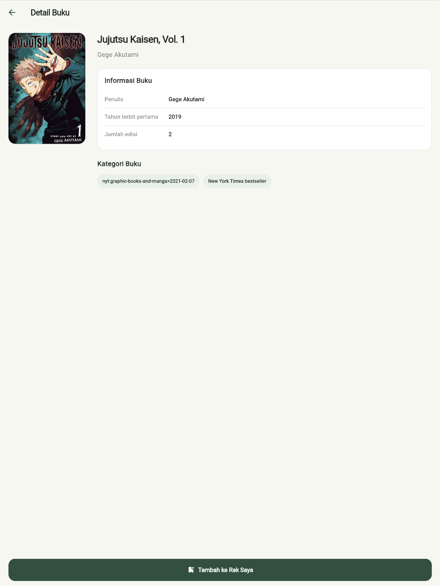

### Tambah Buku

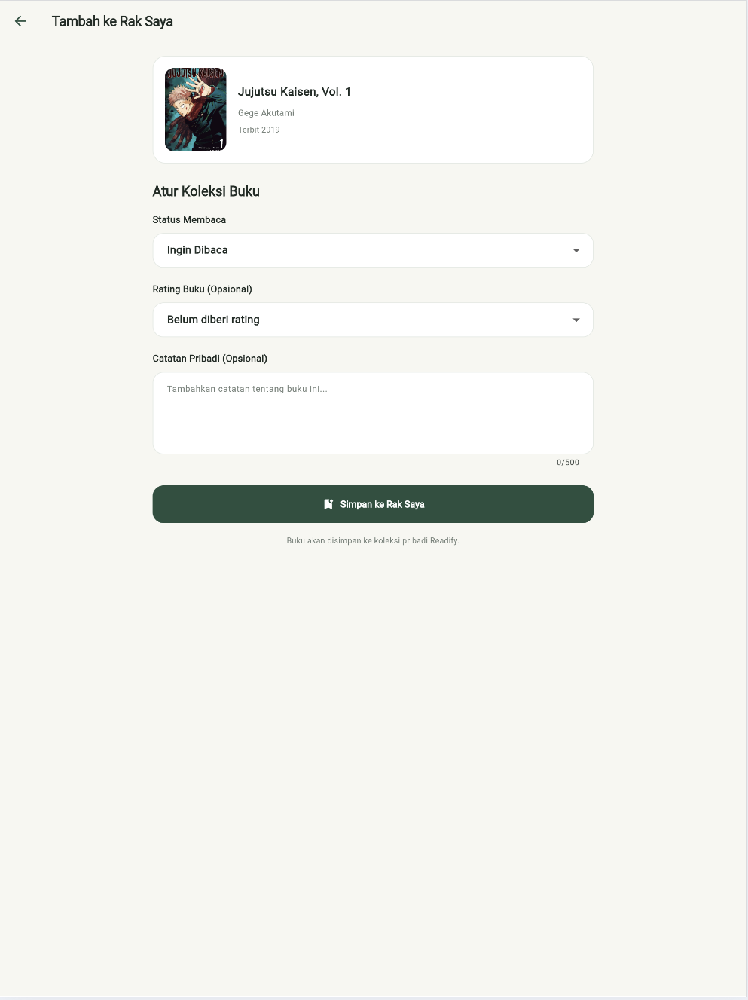

### Edit Buku

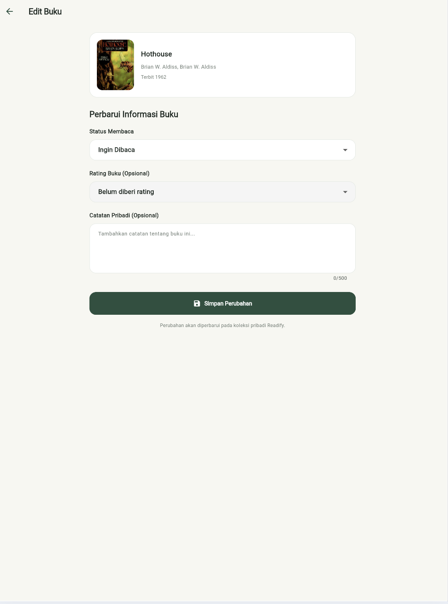

### Rak Saya

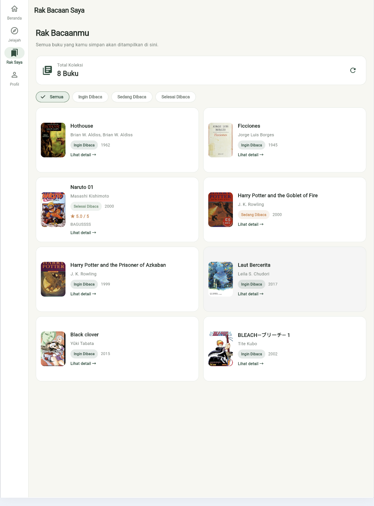

### Detail Buku Tersimpan

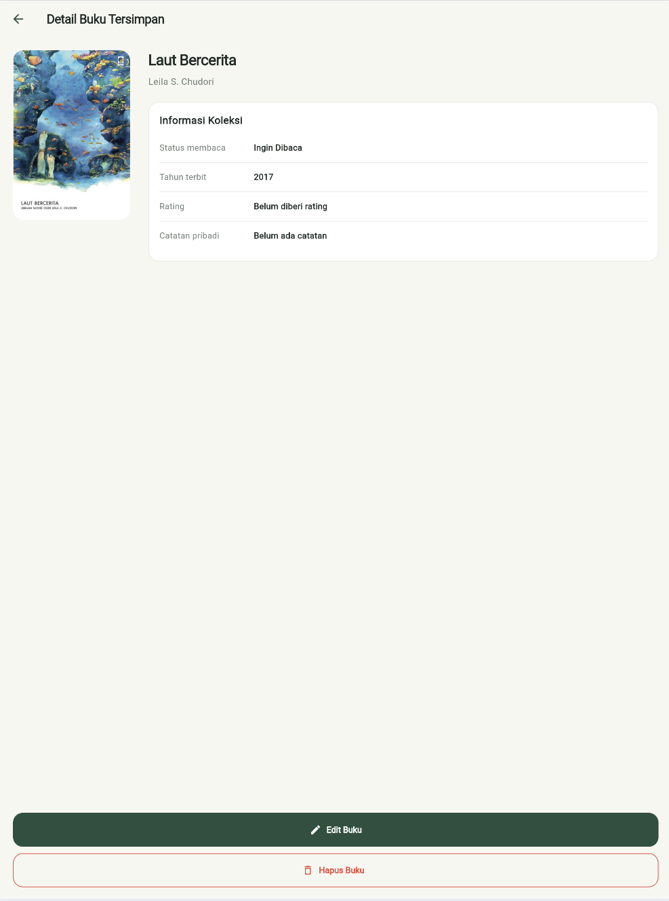

### Profil


### Responsive Layout

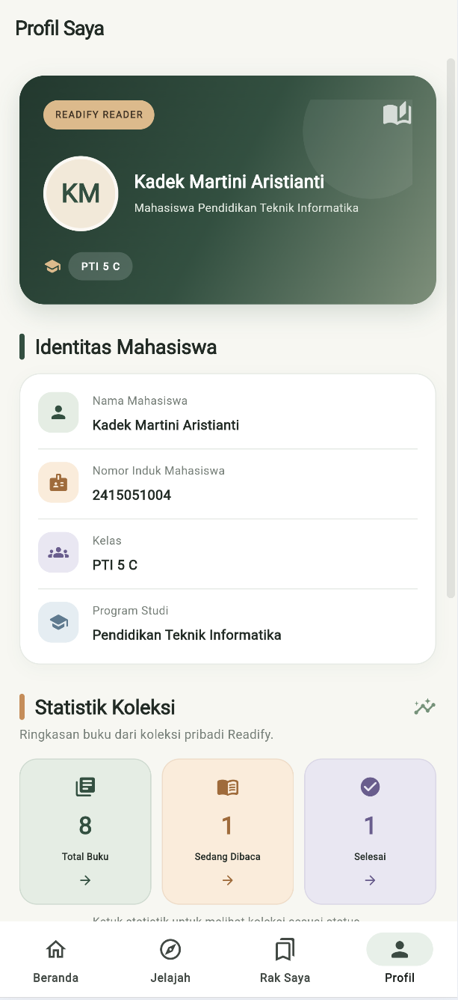

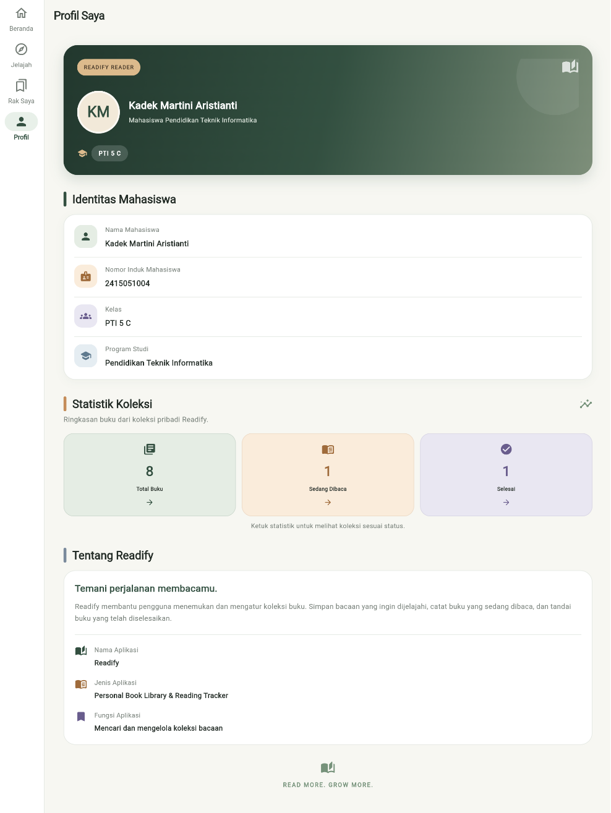

### Bukti REST API

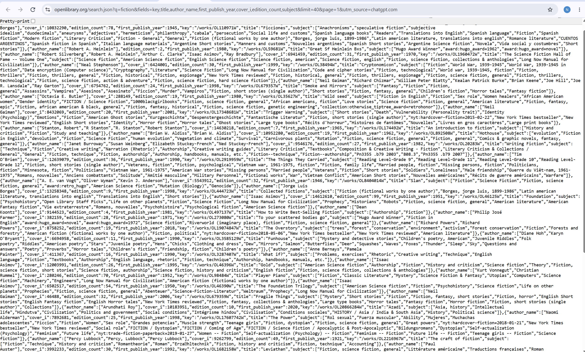

### Bukti Database

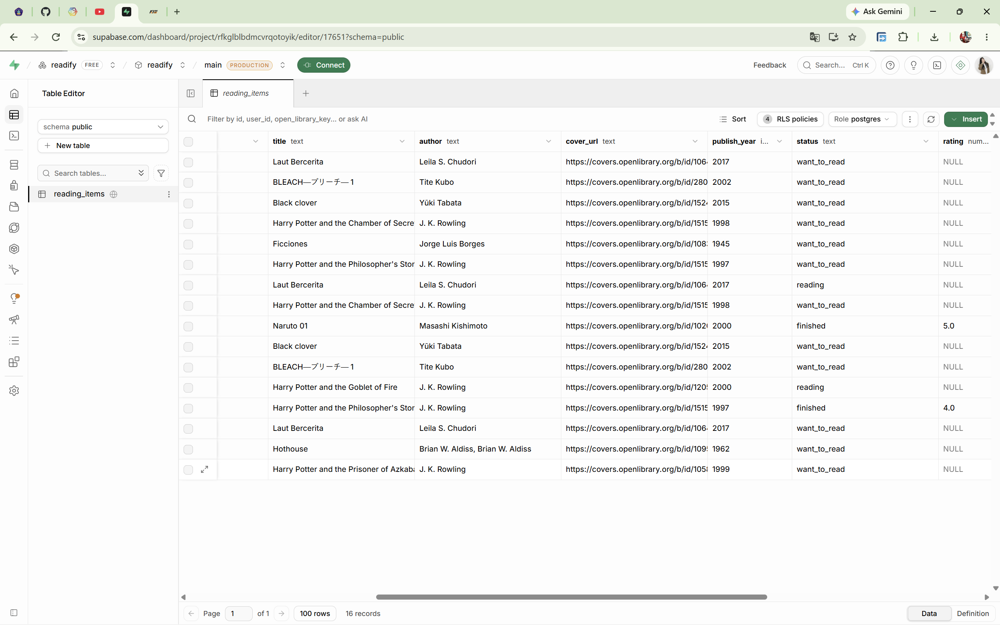

### Bukti Git Log

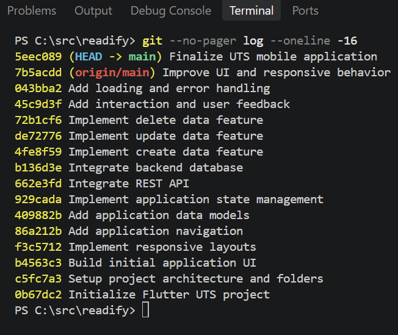

## Cara Menjalankan Project

Pastikan Flutter SDK dan perangkat Android atau emulator sudah tersedia.

1. Clone repository:

```bash
git clone https://github.com/kadekmartini/UTS_2415051004-Kadek-Martini-Aristianti.git
```

2. Masuk ke folder project:

```bash
cd UTS_2415051004-Kadek-Martini-Aristianti
```

3. Instal dependency:

```bash
flutter pub get
```

4. Konfigurasikan URL project dan publishable key Supabase pada konfigurasi aplikasi. Pastikan menggunakan publishable key, bukan service_role key.

5. Siapkan tabel database menggunakan file `supabase/schema.sql` melalui Supabase SQL Editor. Aktifkan Anonymous Sign-In pada Supabase Auth sesuai konfigurasi aplikasi.

6. Jalankan aplikasi:

```bash
flutter run
```

7. Periksa kode dan pengujian:

```bash
flutter analyze
flutter test
```

## Build APK

Perintah build release untuk perangkat Android ARM64:

```bash
flutter build apk --release --target-platform android-arm64
```

Perintah tersebut digunakan setelah memastikan perangkat tujuan mendukung ARM64.

Hasil build secara default tersedia di:

`build/app/outputs/flutter-apk/app-release.apk`

## Download Aplikasi dan Dokumentasi

**APK Readify:**

[Download UTS_2415051004_Kadek-Martini-Aristianti.apk](./UTS_2415051004_Kadek-Martini-Aristianti.apk)

**PDF Dokumentasi:**

[Download UTS_2415051004_Kadek-Martini-Aristianti.pdf](./docs/UTS_2415051004_Kadek-Martini-Aristianti.pdf)

File APK dan PDF ditambahkan ke repository setelah proses build dan finalisasi dokumentasi selesai.

## Git Version Control

Repository menggunakan branch utama `main`.

Riwayat commit dapat diperiksa menggunakan:

```bash
git log --oneline
```

Setiap commit digunakan untuk mendokumentasikan tahapan pengembangan aplikasi sesuai dengan milestone UTS.

## Demo Aplikasi

Alur demonstrasi Readify:

1. Membuka Beranda dan melihat rekomendasi buku.
2. Melakukan pencarian melalui menu Jelajah.
3. Membuka detail buku dari hasil pencarian.
4. Menambahkan buku ke Rak Saya.
5. Memperbarui status membaca, rating, dan catatan.
6. Menghapus buku melalui dialog konfirmasi.
7. Memeriksa sinkronisasi statistik koleksi pada Beranda dan Profil.
8. Memperlihatkan tampilan responsive pada ukuran layar berbeda.

## Penutup

Readify dikembangkan sebagai aplikasi perpustakaan buku pribadi dan pelacak aktivitas membaca. Integrasi Open Library API dan Supabase memungkinkan pengguna mencari informasi buku serta mengelola koleksi bacaan melalui perangkat mobile.
